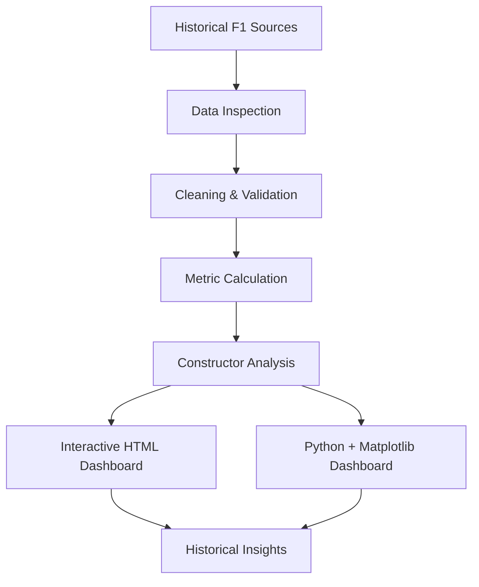

# 🏎️ CONSTRUCTOR WARS
### The Battle for Formula 1 Team Supremacy

<p align="center">
  
  
  
  
</p>

<p align="center">
  <strong>Every season tells a story. Every constructor leaves a legacy.</strong>
  <br/>
  Explore the rivalries, victories, championship battles, and performance trends that have shaped Formula 1 history.
</p>

---

## 🏁 About the Project

**Constructor Wars** is a Formula 1 data analytics and visualization project that explores the historical performance of constructors using real-world racing data.

From championship-winning dynasties to teams fighting for every podium, the project transforms historical race records into meaningful visual insights.

The project delivers the same analytical foundation through **two complementary implementations**:

- 🌐 **Interactive HTML Dashboard** — explore constructor rivalries, historical rankings, and performance trends through interactive visualizations and filters.
- 🐍 **Python + Matplotlib Dashboard** — analyse and present historical Formula 1 performance through carefully designed, reproducible charts.

The goal is simple: make decades of Formula 1 statistics easier to explore, understand, and compare.

## 📊 What Can You Explore?

| Analysis | What it reveals |
|---|---|
| 🏆 Championship Dominance | Constructors with the greatest championship success |
| 📈 Historical Performance | How competitive positions and season results changed over time |
| 🥇 Grand Prix Victories | Teams with the most race wins |
| 🏅 Podium Finishes | Constructors that consistently reached the podium |
| 👨‍🚀 Driver Contributions | Driver-level achievements and their contribution to team success, where supported by the data |
| 🎯 Qualifying vs Race Performance | Relationships between starting positions and finishing results, where reliable records are available |
| 🏎️ Constructor Comparisons | Historical performance across selected teams, seasons, and circuits |

> **Data integrity comes first:** every metric must be calculated from the source records. Missing values, incomplete seasons, and changes in historical scoring systems must be handled carefully.

---

## 🖥️ Two Dashboards. One Formula 1 Story.

### 01 — Interactive HTML Dashboard

**Explore the data. Follow the rivalries. Discover the trends.**

The HTML implementation focuses on interactive exploration, allowing users to investigate historical constructor performance through charts and filters.

**Planned capabilities**
- Interactive charts and tooltips
- Constructor and season filtering
- Historical performance comparisons
- Dynamic rankings and metric updates
- A Formula 1-inspired visual identity

<p align="center">
  <!-- Add your actual preview GIF at assets/html-dashboard-preview.gif -->
  <!-- Example:  -->
  <em>Dashboard preview: add your actual HTML dashboard screenshot or GIF here.</em>
</p>

### 02 — Python + Matplotlib Dashboard

**The same historical data. A Python-powered analytical view.**

The Python implementation uses Pandas for data analysis and Matplotlib for visualisation, with the supplied Constructor Wars background as its visual foundation.

**Planned capabilities**
- Historical constructor rankings
- Season-by-season performance charts
- Grand Prix wins and podium comparisons
- Driver or constructor performance analysis
- Reproducible data processing and chart generation

<p align="center">
  <!-- Add your actual preview image at assets/matplotlib-dashboard-preview.png -->
  <!-- Example:  -->
  <em>Dashboard preview: add your actual Matplotlib dashboard image here.</em>
</p>

---

## 🧠 The Data Behind the Rivalries

The project uses a consolidated historical Formula 1 dataset containing **28,180 records across 74 columns**, including:

- 27,590 Grand Prix result records
- 590 sprint result records
- Historical coverage from 1950 through 2026, with 2026 incomplete in the supplied dataset

The dataset brings together driver results, constructors, race information, qualifying data, finishing status, and championship-related records.

### Data sources

| Source | Purpose |
|---|---|
| [TracingInsights — RaceData](https://github.com/TracingInsights/RaceData) | Main historical data archive and source documentation |
| [J. Trotman — Formula 1 Race Data](https://www.kaggle.com/datasets/jtrotman/formula-1-race-data) | Original historical dataset reference |
| [J. Trotman — Formula 1 Race Events](https://www.kaggle.com/datasets/jtrotman/formula-1-race-events) | Race-event data reference |
| [Rohan Rao — Formula 1 World Championship](https://www.kaggle.com/datasets/rohanrao/formula-1-world-championship-1950-2020) | Historical reference for cross-checking and analysis |

The consolidated dataset is designed to support both dashboard implementations. Original source tables should be retained for verification and future enrichment.

### Important data considerations

- Grand Prix results and sprint results are distinct record types.
- Sprint wins must not be counted as Grand Prix wins.
- Cumulative standings must not be summed across every race round.
- Championship titles must be counted once per constructor per completed championship season.
- Missing qualifying or finishing information must not be replaced with invented values.
- Historical points totals are not perfectly comparable across eras because Formula 1 scoring systems have changed.

These rules help prevent attractive charts from presenting misleading statistics.

---

## 🛠️ Technology Stack

<p align="center">
  
  
  
  
  
  
</p>

| Technology | Role |
|---|---|
| Python | Data processing and reproducible analysis |
| Pandas | Dataset loading, cleaning, aggregation, and validation |
| Matplotlib | Python dashboard visualisations |
| HTML | Structure of the interactive web dashboard |
| CSS | Styling and dashboard layout |
| JavaScript | Interactive charts, filters, and browser-side calculations |
| CSV | Consolidated historical dataset |

The HTML and Python implementations share the same analytical objective, but their interaction models and rendering technologies are different.

---

## 🚀 Getting Started

<details>
<summary><strong>🐍 Run the Python + Matplotlib dashboard</strong></summary>

### 1. Clone the repository

```bash
git clone https://github.com/YOUR_USERNAME/constructor-wars.git
cd constructor-wars
```

Replace `YOUR_USERNAME` with your GitHub username and `constructor-wars` with your actual repository name.

### 2. Create a virtual environment

```bash
python -m venv .venv
```

Activate it on Windows:

```bash
.venv\Scripts\activate
```

On macOS or Linux:

```bash
source .venv/bin/activate
```

### 3. Install dependencies

```bash
pip install pandas matplotlib numpy openpyxl
```

### 4. Run the dashboard script

After adding the Python source and required assets to your repository, run:

```bash
python constructor_wars_dashboard.py
```

Ensure that the script's paths point to the actual CSV and background image locations.

The output image and any optional PDF should be generated by the script.

</details>

<details>
<summary><strong>🌐 Open the interactive HTML dashboard</strong></summary>

If the dashboard is self-contained, open the generated HTML file directly in a modern browser.

For example:

```text
constructor_wars_dashboard.html
```

If the implementation uses external libraries or local assets, follow the project's documented launch instructions instead.

For local development, a simple Python HTTP server can be used:

```bash
python -m http.server 8000
```

Then open:

```text
http://localhost:8000
```

This command serves the current directory; it does not build the dashboard. Ensure the HTML file and its required assets are present in that directory.

</details>

---

## 📂 Suggested Repository Structure

```text
constructor-wars/
│
├── README.md
├── data/
│   └── constructor_wars_detailed_all_years.csv
│
├── assets/
│   ├── constructor-wars-background.png
│   ├── html-dashboard-preview.gif
│   └── matplotlib-dashboard-preview.png
│
├── html-dashboard/
│   └── constructor_wars_dashboard.html
│
└── python-dashboard/
    ├── constructor_wars_dashboard.py
    └── requirements.txt
```

This is a suggested structure. Adapt the paths to match the files you actually commit.

**Data privacy and file size:** check the dataset's redistribution terms before committing the complete CSV. If it is too large or the source licence does not permit redistribution, document the original download source and provide instructions for obtaining the data instead.

---

## 🔬 Project Workflow



The same verified data foundation powers both implementations, while each dashboard presents the findings in a different way.

---

## 🎯 Project Goals

- Explore historical Formula 1 constructor performance.
- Identify championship-winning teams and long-term dominance.
- Compare victories, podiums, and season results.
- Understand how competition changed across eras.
- Present real-world sports data through clear visual storytelling.
- Demonstrate data analysis, visualization, and dashboard development using two approaches.
- Prioritise accurate calculations and transparent data limitations.

---

## 🗺️ Future Improvements

Potential extensions include:

- More detailed driver-versus-teammate analysis
- Additional qualifying and race-pace comparisons
- Circuit-specific constructor performance
- Reliability and non-finish analysis
- More detailed season and era comparisons
- Improved interactive filtering and drill-down analysis

Future features will depend on the availability and quality of the underlying data.

---

## 📚 Credits & Data Attribution

This project uses Formula 1 historical datasets referenced above for educational and analytical purposes.

Formula 1, team names, and related trademarks belong to their respective owners. **Constructor Wars is an independent analytics project and is not affiliated with, endorsed by, or sponsored by Formula 1 or any racing team.**

Check the licence of each source dataset before redistributing its contents.

---

## 🏁 Final Lap

Formula 1 is more than a collection of race results. It is a history of engineering, strategy, competition, and teams that defined different eras of motorsport.

**Constructor Wars turns that history into data you can explore.**

<p align="center">
  <strong>Built around the data. Driven by the story.</strong>
  <br/><br/>
  
</p>

<p align="center">
  <sub>Independent Formula 1 historical analytics project · HTML + Python/Matplotlib</sub>
</p>
